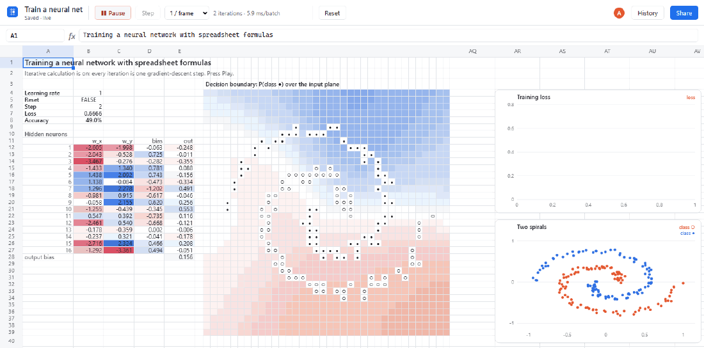
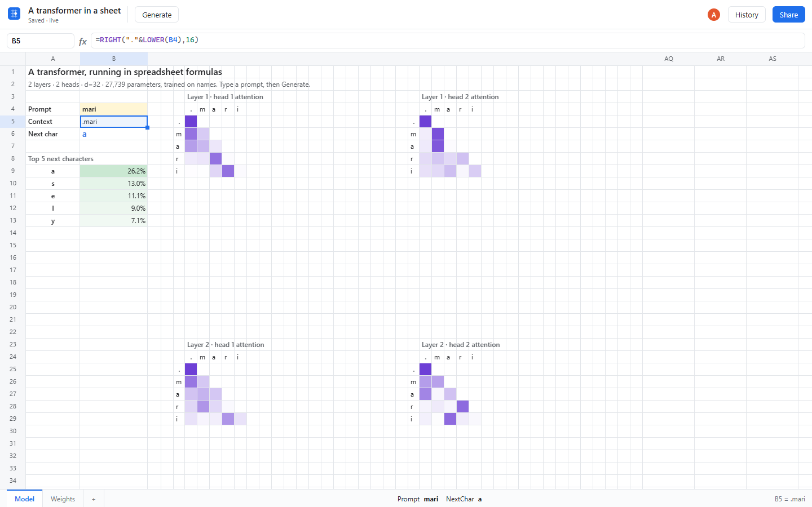
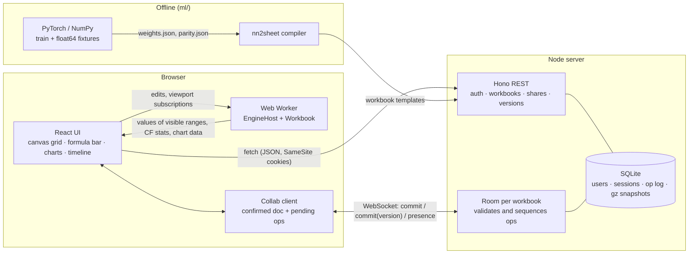

# excelsior

**I built a spreadsheet engine from scratch, then trained a neural network inside its cells.**

[](https://github.com/aamodbhatt/excelsior/actions/workflows/ci.yml)
[](LICENSE)




*Recorded from the running app (Edge, via Playwright). Every number on screen is a formula. The heat-map is
`P(class ●)` over the input plane, computed by the network's own forward pass in cells. Each frame advances
iterative calculation, and **one iteration is one gradient-descent step**.*



*A char-level GPT (2 layers, 2 heads, d=32, 27,739 parameters) trained in PyTorch, compiled to formulas.
Type a prompt, read the top-5 next characters, and watch all four attention heads. **Generate** appends the
prediction to the prompt. Its outputs match PyTorch float64 to within **5.8e-15**.*

## Why

Spreadsheets are the most widely used programming environment in the world, and the least respected.
A recalculation engine is a small dataflow compiler: parsing, dependency graphs, incremental scheduling,
cycles and fixed points. I wanted to build one properly. Then I wanted a test that would show whether it really
was fast and exact, so I made it train a neural network.

## What it does

- **A formula engine from scratch** (`packages/engine`, TypeScript strict, no DOM). It has a tokenizer and Pratt parser with
  Excel precedence (`-2^2 = 4`, left-associative `^`), A1/absolute/whole-row/whole-column and cross-sheet
  references, defined names, array literals, `%`, `&`, `@`, the spill operator `A1#`, a minimal-parens
  printer, and Excel error values.
- **Dynamic arrays**: spilling with `#SPILL!` detection and recovery, broadcasting (`SEQUENCE(3)+SEQUENCE(1,4)`),
  `LET`, `LAMBDA` (including named LAMBDAs), `MAP`, `REDUCE`, `SCAN`, `BYROW`, `BYCOL` and `MAKEARRAY`.
- **125 functions** (117 built-ins plus 8 special forms such as `IF`, `LET` and `LAMBDA`): math, logical, text, lookup (`XLOOKUP`, `XMATCH`, `INDEX`/`MATCH`, `FILTER`,
  `SORT`, `UNIQUE`, `TAKE`/`DROP`, `VSTACK`/`HSTACK`, ...), statistics, and matrix work (`MMULT`, `TRANSPOSE`,
  `SUMPRODUCT`, `EXP`, `LN`, `TANH`, `RANDARRAY` with a seeded mode). Numeric arrays stay in `Float64Array`s.
- **Incremental recalculation** over a range-aware dependency index. `SUM(A1:A1000000)` is one edge, not a
  million. Scheduling uses an iterative Tarjan SCC pass, so 100k-long chains don't overflow the stack.
  Cycles become `#CIRC!`, or with **iterative calculation** on, they run Excel-style (max iterations,
  max change).
- **A neural-net-to-spreadsheet compiler** (`packages/nn2sheet`) that emits workbooks whose formulas *are*
  the model:
  - an MLP whose forward pass, backward pass and parameter update are all formulas, trained by iterative calculation;
  - a trained transformer, with every activation and attention map a visible cell range.
- **A collaborative web app** (`apps/web`, React 19 + Vite).
  - The grid is canvas-rendered and virtualized, and scrolls through 1,048,576 rows.
  - Calculation runs in a Web Worker.
  - The formula bar has syntax highlighting, autocomplete and signature help.
  - It supports sheet tabs, fill handle, TSV copy/paste (interoperates with Excel and Sheets), number formats, color-scale conditional formatting, line and scatter charts, trace precedents/dependents arrows, undo/redo and keyboard shortcuts.
  - It shows live cursors of collaborators.
  - A **version timeline** can replay training frame by frame.
- **A server** (`apps/server`, Node 24 + Hono + `node:sqlite` + WebSocket).
  - Auth: email/password, scrypt, HttpOnly SameSite cookies, Origin-checked writes and WebSocket upgrades.
  - Workbook CRUD, and share links with editor/viewer roles.
  - Server-sequenced real-time collaboration with presence.
  - An op log with snapshots, so any version can be rebuilt.

## Quickstart

Requires Node 24 (and, only to retrain the model, Python 3.12 with [uv](https://docs.astral.sh/uv/)).

**macOS / Linux**

```bash
git clone https://github.com/aamodbhatt/excelsior && cd excelsior
npm ci && npm run build
npm start            # http://127.0.0.1:8093  ->  sign up  ->  "Train a neural net"  ->  ▶ Train
```

**Windows (PowerShell)**

```powershell
git clone https://github.com/aamodbhatt/excelsior; cd excelsior
npm ci; npm run build
npm start            # open http://127.0.0.1:8093
```

For development with hot reload, run `npm run dev` (API on :8093, Vite on :5193). Other commands:

| Command | What it runs |
| --- | --- |
| `npm test` | 195 unit, property and integration tests (Vitest) |
| `npm run e2e` | Playwright end-to-end tests against the production build |
| `npm run bench`, `npm run bench:training` | engine and training benchmarks |
| `npm run lint`, `npm run typecheck` | Biome and `tsc --strict` |
| `cd ml && uv run pytest` | the Python reference-model tests |

## How do you train a neural network with formulas?

Excel has a little-known switch, **iterative calculation**. It exists for financial models with deliberate circular
references. With it on, a cell may depend on itself: `=A1+1` becomes a counter that advances each time
the sheet recalculates.

Gradient descent is exactly that kind of loop. It says: *new weights = old weights - learning rate × gradient
of the loss at the old weights*. So the compiler writes every weight as a self-referencing cell:

```
Train!B12   =IF(Reset, Net!D5, B12 - LearningRate * Net!BN5)
              ^ initial value     ^ old value    ^ the gradient cell for this weight
```

Everything between the weights and the gradients is ordinary dynamic-array formulas on the `Net` sheet, one
spilling block per equation of backpropagation (references abbreviated here):

```
Z1  =MMULT(X, TRANSPOSE(W)) + TRANSPOSE(b)        200 x 16
A1  =TANH(Z1#)
Z2  =MMULT(A1#, v) + c
P   =1/(1+EXP(-Z2#))
dZ2 =(P# - y)/200
dZ1 =MMULT(dZ2#, TRANSPOSE(v)) * (1 - A1#^2)
dW  =MMULT(TRANSPOSE(dZ1#), X)                    16 x 2   <- read by the weight cells
```

The weights read the gradients, and the gradients depend on the weights: one big circular reference. The subtle
part is **what an "iteration" means**. Within a cycle, excelsior evaluates cells in a fixed **row-major order**
(sheet, then row, then column), and each cell reads the newest values (Gauss–Seidel). The weights sit on the
first sheet, so each iteration they update first from the previous iteration's gradients, then the whole
forward and backward pass recomputes from the new weights. That is *exactly* one step of full-batch gradient
descent. The test suite runs 200 iterations next to a NumPy implementation, and the two agree to **2.2e-15**.

The loss curve is a column of self-referencing cells, `=IF(Step=k, Loss, IF(Reset,"",self))`, that each
capture the loss at one step. The decision-boundary heat-map is the same network evaluated on a 36×36 grid
of inputs, with a red-white-blue color scale pinned at 0, 0.5 and 1. The white band *is* the boundary.

## Results and benchmarks

Measured on an Intel Core Ultra 9 275HX laptop (32 GB, Windows 11), Node 24.22, single thread. Raw output:
[`docs/benchmarks.json`](docs/benchmarks.json) and [`docs/training-benchmarks.json`](docs/training-benchmarks.json).
Timings vary about ±30% between runs; the table shows one full run.

| Benchmark | Result |
| --- | --- |
| 1,000,000-cell sheet (100k constants + 900k formulas): full recalculation | **1.46 s** (900k formulas evaluated) |
| Same sheet: edit one input, incremental recalculation | **0.09 ms** |
| Same sheet + `=SUM(A1:A100000)`: edit an input under the range | **0.67 ms** (the range is one edge) |
| 100,000-long dependency chain: edit the head | **65 ms** |
| `MMULT` 256×256 · 256×256 (forced recalculation) | **13.1 ms** (≈2.6 GFLOP/s) |
| In-sheet MLP training (Node, no UI) | **973 gradient steps/s** |
| In-sheet MLP training (browser worker, with rendering) | ≈780 steps/s (4,600+ steps in ~6 s) |
| Transformer forward pass on a prompt change | **2.4 ms** median |
| Grid scrolling through 1,048,576 computed rows (`=SEQUENCE(1048576)`, ~360 rows per frame, headless Edge, no vsync cap) | frame interval p50 **4.2 ms**, p95 4.4 ms, max 8 ms |
| MLP in formulas vs NumPy, 200 iterations, all 65 parameters plus the loss | max abs difference **2.2e-15** |
| Transformer in formulas vs PyTorch float64, 7 prompts, logits and all attention maps | max abs difference **5.8e-15** |

The transformer was trained for 3,000 AdamW steps on the
[makemore names](https://github.com/karpathy/makemore) dataset on the pod's CPU. That took 55 s; no GPU was used.
It reached a validation loss of **2.020 nats/char**. The 1M-cell sheet uses about 1.7 GB of heap. Formula cells
are the dominant cost (see the roadmap).

## How it works



The clever parts:

- **Range-aware dependency index.** A formula registers each referenced range once, deduplicated across
  formulas, in per-column buckets (wide ranges go on a short scan list). A changed cell finds its
  dependents with a point query. There are no per-cell edges, so whole-column references are cheap.
- **Shape interning.** Fill-down formulas (`=A1*2`, `=A2*2`, ...) share one compiled closure keyed by
  their R1C1 shape. Only the anchor cell differs.
- **One scheduler for everything.** Each recalculation collects the affected formulas and runs an
  *iterative* Tarjan pass (so 100k chains don't overflow the stack), then evaluates SCCs in topological order.
  Acyclic SCCs run once. Cyclic ones become `#CIRC!`, or iterate in row-major Gauss–Seidel order. Cells
  downstream of a cycle that don't feed back into it run once after the loop, not every iteration. That
  keeps the 36×36 heat-map out of the training inner loop.
- **Iteration state = integrator cells.** A cell is an *integrator* if it reads a value across a back edge
  of the cycle order, such as the weights, the step counter and the loss history. Every other cell in a cycle is a pure
  function of the integrators within one iteration. So the integrators are the *entire* state: persisting
  them makes any snapshot reproducible bit for bit. That is what makes the version timeline able to replay training.
- **Float64 fast paths.** `RangeRef`s stay lazy until read. Numeric grids flow through `MMULT`, `TANH`,
  `EXP` and broadcasting arithmetic as `Float64Array`s, with a generic path only when errors or text appear.
- **Server-sequenced collaboration.** Every edit is a last-writer-wins overwrite (cells, settings, iteration
  state), so a single sequencer gives a total order and needs no transformation. See [DESIGN](docs/DESIGN.md#collaboration)
  for why this beats a CRDT here.

## Design decisions and trade-offs

- **Own engine, not a library.** The point is the engine. Writing it made it possible to define iterative
  semantics precisely, and to test them against NumPy.
- **Row-major order inside cycles.** Excel does not document its order within circular chains. LibreOffice uses
  sheet → row → column. We define and test that rule, and the compiler lays sheets out so that it yields exact
  gradient descent.
- **Server-sequenced ops instead of Yjs.** Spreadsheet edits are overwrites of whole cells, not concurrent text
  merges. A sequencer gives version numbers for free (version history = op log), lets the server enforce
  roles on every op, and keeps no CRDT metadata. Trade-off: offline editing is limited to a resend queue.
- **The worker owns values; the UI owns the document.** Only visible ranges cross the thread boundary, so
  scrolling a million rows never ships a million values.
- **Training runs on one client.** Other clients follow its committed iteration state, about once a second.
  Each commit is also a version, which is what the timeline scrubs through.

## Testing

| Suite | What it checks |
| --- | --- |
| Parser (property-based, fast-check) | `parse(print(ast)) == ast` for 1,500 random ASTs; printing is a fixed point; precedence corner cases |
| Function conformance | 130 formula → value cases across all categories, plus seeded randomness |
| Recalculation | incremental vs. full recompute agree on 200 random DAGs with random edits (property); ranges, chains, cross-sheet, names |
| Spills, cycles, iteration | `#SPILL!` block/unblock, `A1#`, `#CIRC!`, fixed-point convergence, Gauss–Seidel GD, iteration-state round trip |
| Worker protocol | client ↔ host over structured clone: patches, errors, forced iterations, traces |
| Parity | in-sheet MLP vs NumPy for 200 steps; transformer vs PyTorch float64 for 7 prompts |
| API integration | auth, CSRF/Origin rejection, roles, share links, live WebSocket sync, presence, version restore |
| Playwright e2e | sign-up and editing; fill handle; two users through a share link; training until the loss drops 4×; time travel; reset; transformer generation |
| Python (pytest, mypy --strict, ruff) | finite-difference gradient check, stable loss, causal-softmax equivalence, export round trip |

Totals: **195** Vitest tests, **5** Playwright tests and **9** pytest tests, all passing.

## Project layout

```
packages/engine     formula language, evaluator, functions, dependency graph, scheduler, worker protocol
packages/doc        document model, ops, formula translation (shared by client and server)
packages/nn2sheet   MLP and transformer -> workbook compiler, fixtures, parity tests
apps/server         Hono API, auth, rooms (collaboration), SQLite persistence
apps/web            React app: canvas grid, formula editor, charts, timeline, e2e tests
ml/                 NumPy MLP reference, PyTorch tiny GPT, training and export
scripts/            dev runner, README capture, GIF assembly
docs/               DESIGN.md, assets, benchmark output
```

## Roadmap

- **XLSX import/export.** Workbooks currently live in excelsior's JSON format. An exporter must write
  `_xlfn.` prefixes, dynamic-array cell metadata and `<calcPr iterate="1">`. It has **not** been built or
  checked against real Excel, so neither the templates nor their iterative semantics have been verified in Excel.
- Insert and delete rows and columns, with reference rewriting.
- Lower memory per formula cell: dense typed arrays instead of objects for 1M-formula sheets.
- More functions (dates, financial), more conditional-format rule types, and editable charts.
- Mini-batch SGD and Adam variants of the training template.

## License

[MIT](LICENSE) © 2026 Aamod Bhatt
